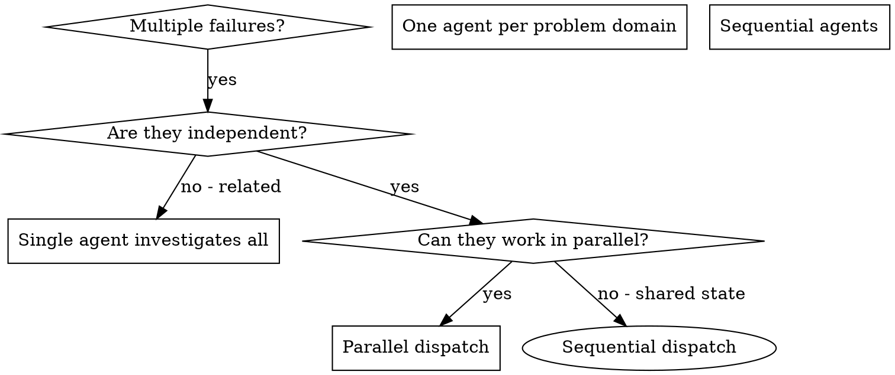

# Dispatching Parallel Agents

## Overview

You delegate tasks to specialized agents with isolated context. By precisely crafting their instructions and context, you ensure they stay focused and succeed at their task. They should never inherit your session's context or history — you construct exactly what they need. This also preserves your own context for coordination work.

When you have multiple unrelated failures (different test files, different subsystems, different bugs), investigating them sequentially wastes time. Each investigation is independent and can happen in parallel.

**Core principle:** Give each independently completable slice its own isolated worker, and delegate only when the slice is worth the coordination cost. The count is not a quota: a task too small to hand over, a host without subagents, or a task whose slices share state runs inline without ceremony.

## When to Use



**Use when:**
- Several failures or work slices have different root causes
- Multiple subsystems are broken independently
- Each problem can be understood without context from others
- No shared state between investigations

**Don't use when:**
- Failures are related (fix one might fix others) — investigate together first
- Understanding requires seeing the full system state
- Agents would interfere: same files, same service, same database, same port
- You don't know what's broken yet (exploratory debugging is inherently sequential)
- One slice is too small to justify the coordination cost
- The host has no subagent tool — run the work inline; never fabricate a dispatch

## The Pattern

### 1. Identify Independent Domains

Group failures by what's broken:
- File A tests: Tool approval flow
- File B tests: Batch completion behavior
- File C tests: Abort functionality

Each domain is independent - fixing tool approval doesn't affect abort tests.

### 2. Create Focused Agent Tasks

Each agent gets:
- **Specific scope:** One test file or subsystem
- **Clear goal:** Make these tests pass
- **Constraints:** Don't change other code
- **Interfaces:** only where the slice shares a real boundary with a sibling —
  exact consumed/produced names and signatures, so a worker who sees only their
  task still matches neighboring code
- **Expected output:** Summary of what you found and fixed

### 3. Dispatch with the Host's Delegation Mechanism

Use the API the current host actually exposes — its task/subagent tool, its
agent-role selector, or an isolated worker session — not another platform's
example. When that tool supports concurrent dispatch, issue the independent
slices as one batch; verify from its own documentation or a prior run whether
they actually run concurrently rather than inferring it from call placement,
since a host may serialize queued workers. Each worker keeps the isolated
scope, constraints and interfaces from step 2.

**Workspace isolation is not this skill's call.** Whether the slices need
separate worktrees, who creates them and who removes them on completion
belongs to `using-git-worktrees`; native harness facilities own placement and
cleanup, and a dispatcher that invents an extra `git worktree add` per worker
leaves state the harness cannot see. Reuse whatever isolation the plan and the
host already established.

### 4. Review and integrate

- Read each summary and check the changed code, not only the claim.
- Look for conflicting edits when two slices touch the same file or concept.
- Run the checks the integrated change needs: the suites the touched code
  belongs to, going suite-wide when slices shared code or a targeted run
  fails. Scale this to the change, not to the number of workers.
- Integrate all of it before reporting; a returned summary is not a finished
  slice.

## Agent Prompt Structure

Good agent prompts are:
1. **Focused** - One clear problem domain
2. **Self-contained** - All context needed to understand the problem
3. **Specific about output** - What should the agent return?

```markdown
Fix the 3 failing tests in src/agents/agent-tool-abort.test.ts:

1. "should abort tool with partial output capture" - expects 'interrupted at' in message
2. "should handle mixed completed and aborted tools" - fast tool aborted instead of completed
3. "should properly track pendingToolCount" - expects 3 results but gets 0

These are timing/race condition issues. Your task:

1. Read the test file and understand what each test verifies
2. Identify root cause - timing issues or actual bugs?
3. Fix by:
   - Replacing arbitrary timeouts with event-based waiting
   - Fixing bugs in abort implementation if found
   - Adjusting test expectations if testing changed behavior

Do NOT just increase timeouts - find the real issue.

Return: Summary of what you found and what you fixed.
```

## Common Mistakes

- **Too broad** — "Fix all the tests": the agent wanders. Name one file or one
  subsystem.
- **No context** — "Fix the race condition": the agent doesn't know where.
  Paste the error messages and the failing test names.
- **No constraints** — the agent refactors the world. Say "do not change
  production code" or "fix tests only".
- **Vague output** — "Fix it" leaves you guessing what changed. Ask for the
  root cause and the changes made.
- **No interfaces** — sibling tasks invent each other's names. State the names
  and signatures that cross a real sibling boundary.
- **Improvised isolation** — each agent runs its own `git worktree add`.
  Set up isolation once with `using-git-worktrees`, then dispatch.

## Real example

Six test failures across three files after a refactoring:

- `agent-tool-abort.test.ts` — 3 failures (timing)
- `batch-completion-behavior.test.ts` — 2 failures (tools not executing)
- `tool-approval-race-conditions.test.ts` — 1 failure (execution count = 0)

Abort logic, batch completion and race conditions are separate domains, so
three workers each took one file. Result: three fixes, no conflicts. The
session still ran the full suite, because all three touched shared async-wait
code — the scope of verification follows the change, not the worker count.

---

> Source: obra/superpowers (MIT). Adapted for coding-kit: cross-references made local.
